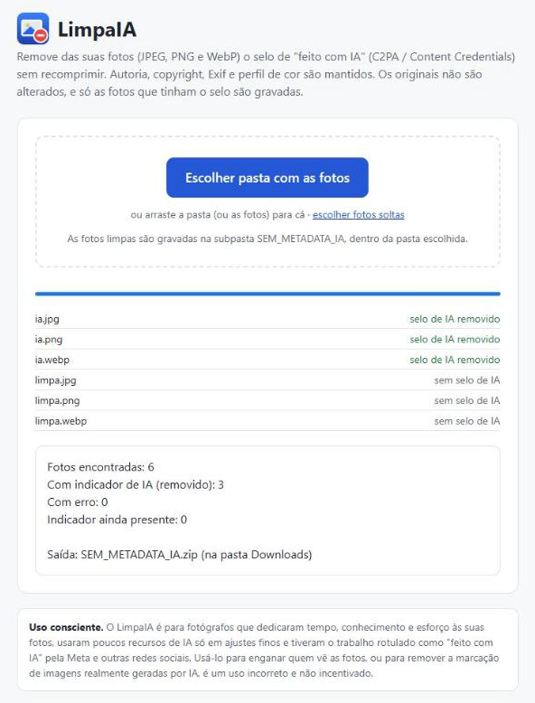
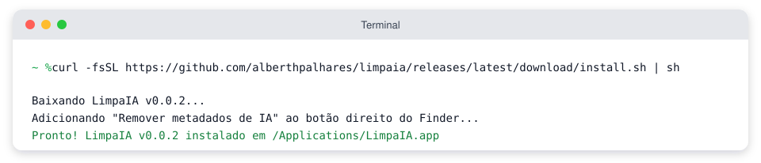
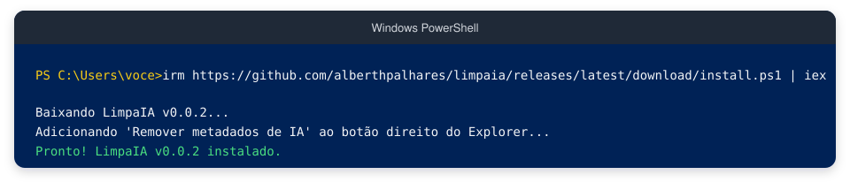
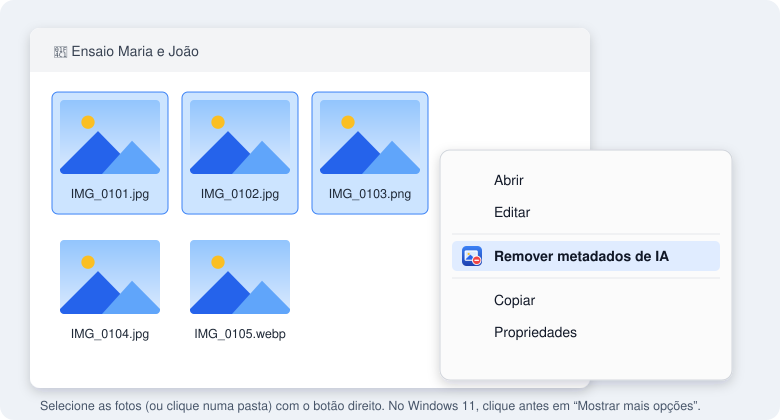
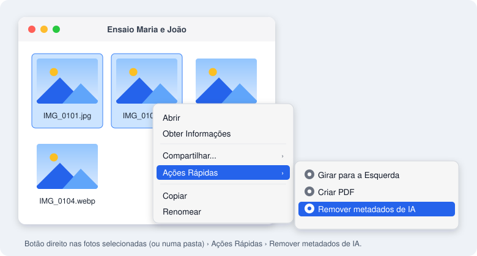
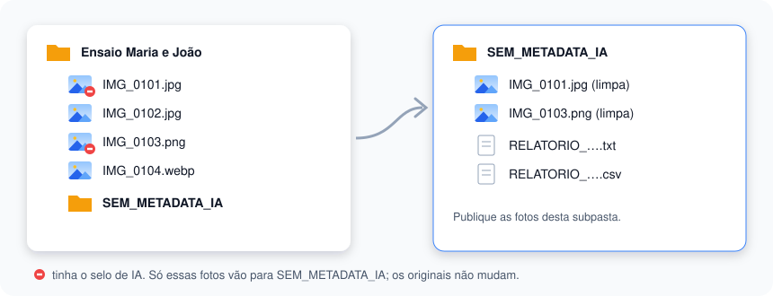

<p align="center">
  
</p>

<h1 align="center">LimpaIA</h1>

<p align="center">
  <b>Tire o selo “Feito com IA” das suas fotos, sem perder nenhuma qualidade.</b><br>
  Para fotógrafos que tiveram o próprio trabalho rotulado como IA por causa de um retoque.
</p>

<p align="center">
  <a href="https://github.com/alberthpalhares/limpaia/releases/latest"></a>
  <a href="https://github.com/alberthpalhares/limpaia/releases"></a>
  <a href="https://github.com/alberthpalhares/limpaia/actions/workflows/ci.yml"></a>
  <a href="LICENSE"></a>
</p>

<p align="center">
  <a href="https://alberthpalhares.github.io/limpaia/"><b>🌐 Usar agora no navegador</b></a> ·
  <a href="#-opção-2-instalar-com-um-comando">💻 Instalar</a> ·
  <a href="#-perguntas-frequentes">❓ Dúvidas</a>
</p>

<p align="center">
  
</p>

> [!IMPORTANT]
> **Uso consciente.** O LimpaIA é voltado a **fotógrafos** que dedicaram tempo, conhecimento e esforço às suas
> fotografias, usaram **poucos recursos de IA só para ajustes finos** e tiveram a produção rotulada como conteúdo
> de IA pela Meta e outras redes sociais. Usar a ferramenta para **enganar o público** que consome as fotografias,
> ou para **remover a marcação de imagens que foram realmente geradas por IA**, é um uso incorreto e não incentivado.

## O que o LimpaIA faz

Quando você usa um recurso de IA no Photoshop ou no Lightroom (como o Preenchimento Generativo para tirar um fio
do céu), o programa grava na foto uma etiqueta invisível, o **C2PA / Content Credentials**. Instagram, Facebook e
outras redes leem essa etiqueta e mostram **“Feito com IA”**, mesmo que 99% da foto seja trabalho seu.

O LimpaIA tira **só essa etiqueta**:

- ✅ **Não recomprime a foto:** a imagem continua idêntica, byte a byte.
- ✅ **Mantém o que importa:** autoria, copyright, dados da câmera (Exif) e perfil de cor.
- ✅ **Não mexe nos originais:** as fotos limpas vão para uma subpasta nova.
- ✅ **Só grava o que precisa:** fotos sem o selo não são copiadas.
- ✅ **Funciona com JPEG, PNG e WebP**, no Windows, no Mac ou no navegador.
- ✅ **Suas fotos não saem do computador.**

## Escolha o seu jeito

|  | 🌐 **No navegador** | 💻 **Instalar com um comando** | 📦 **Baixar o programa** |
|---|---|---|---|
| **Para quem** | Quem quer usar agora, sem instalar | Quem limpa fotos com frequência | Quem prefere não usar o Terminal |
| **Como** | Abrir um link | Colar uma linha no Terminal/PowerShell | Baixar e abrir o arquivo |
| **Botão direito do mouse** | — | ✅ Sim | ✅ Sim |
| **Avisos do sistema** | Nenhum | Nenhum | Um aviso na 1ª vez (dá para liberar) |
| **Atualizações** | Sempre a versão mais nova | Aviso automático, um clique | Aviso automático, um clique |

---

## 🌐 Opção 1: no navegador

1. Abra **https://alberthpalhares.github.io/limpaia/** (funciona no Chrome, Edge, Safari e Firefox).
2. Clique em **Escolher pasta com as fotos** (ou arraste as fotos para a página).
3. Pronto. No **Chrome** e no **Edge**, as fotos limpas aparecem numa subpasta dentro da própria pasta.
   No **Safari** e no **Firefox**, elas são baixadas num arquivo `SEM_METADATA_IA.zip`.

<p align="center"></p>

> Tudo acontece no seu computador: a página não envia as fotos para lugar nenhum.
> Prefere usar sem internet? Baixe o arquivo [`LimpaIA.html`](https://github.com/alberthpalhares/limpaia/releases/latest/download/LimpaIA.html) e abra com dois cliques.

---

## 💻 Opção 2: instalar com um comando

Instalando assim, o Mac e o Windows **não mostram aviso nenhum**, e o item **“Remover metadados de IA”** já
aparece no botão direito do mouse.

### No Mac

1. Abra o app **Terminal**: aperte <kbd>Cmd</kbd> + <kbd>Espaço</kbd>, digite `Terminal` e tecle <kbd>Enter</kbd>.
2. Copie a linha abaixo, cole no Terminal e tecle <kbd>Enter</kbd>:

```sh
curl -fsSL https://github.com/alberthpalhares/limpaia/releases/latest/download/install.sh | sh
```

<p align="center"></p>

### No Windows

1. Abra o **PowerShell**: clique no Menu Iniciar, digite `PowerShell` e tecle <kbd>Enter</kbd>.
2. Copie a linha abaixo, cole no PowerShell (botão direito cola) e tecle <kbd>Enter</kbd>:

```powershell
irm https://github.com/alberthpalhares/limpaia/releases/latest/download/install.ps1 | iex
```

<p align="center"></p>

> O instalador baixa a versão mais recente, **confere se o arquivo veio íntegro** (SHA-256), instala só para o
> seu usuário (não pede senha de administrador) e cria o item no botão direito.

---

## 🖱️ Como usar no dia a dia

Selecione **uma pasta** ou **várias fotos**, clique com o **botão direito** e escolha **Remover metadados de IA**.
Todas as fotos selecionadas são processadas de uma vez, com um relatório só.

<table>
  <tr>
    <th>Windows</th>
    <th>Mac</th>
  </tr>
  <tr>
    <td></td>
    <td></td>
  </tr>
  <tr>
    <td>No Windows 11, clique antes em <b>Mostrar mais opções</b>.</td>
    <td>Fica em <b>Ações Rápidas</b>. Se não aparecer, veja as <a href="#-perguntas-frequentes">dúvidas</a>.</td>
  </tr>
</table>

Também dá para abrir o **LimpaIA** pelo Menu Iniciar (Windows) ou pelo Spotlight (Mac) e escolher a pasta.

## 📂 Onde ficam as fotos limpas

Dentro da pasta das fotos aparece a subpasta **`SEM_METADATA_IA`**, com:

- **só as fotos que tinham o selo de IA**, já limpas e com os mesmos nomes;
- o **relatório** (`RELATORIO_….txt` e `.csv`) com todas as fotos analisadas: quais tinham o selo, o que foi removido e se algo deu errado.

<p align="center"></p>

**Publique as fotos dessa subpasta.** Se nenhuma foto tinha o selo, nada é criado e o LimpaIA avisa.

## 🔄 Atualizações

Uma vez por semana, quando você usa o LimpaIA, ele pergunta ao GitHub se há versão nova (nada sobre as suas fotos
é enviado). Se houver, aparece um aviso: um clique em **Atualizar** e pronto, sem baixar nada à mão.
Quem usa no navegador já está sempre na versão mais nova.

---

## 📦 Opção 3: baixar o programa

Prefere não usar o Terminal? Baixe o arquivo do seu sistema na
[página de downloads](https://github.com/alberthpalhares/limpaia/releases/latest):

| Sistema | Arquivo | Instruções |
|---|---|---|
| Windows 10 e 11 | `LimpaIA.exe` | [LEIA-ME do Windows](packaging/LEIA-ME_Windows.txt) |
| Mac (chip Apple ou Intel, macOS 12+) | `LimpaIA-macOS.zip` | [LEIA-ME do Mac](packaging/LEIA-ME_macOS.txt) |
| Qualquer um, no navegador | `LimpaIA.html` | [LEIA-ME da versão web](packaging/LEIA-ME_Web.txt) |

Como o LimpaIA é gratuito e não tem a assinatura paga da Apple/Microsoft, na **primeira vez** o sistema mostra um
aviso. Os LEIA-ME explicam como liberar em poucos cliques. Com a Opção 2, esse aviso não aparece.

## ❓ Perguntas frequentes

<details>
<summary><b>A rede social vai deixar de mostrar “Feito com IA”?</b></summary>

O LimpaIA remove a etiqueta gravada no arquivo, que é o que as redes leem. Mas elas podem usar outros meios de
detecção, então não há garantia.
</details>

<details>
<summary><b>A foto perde qualidade?</b></summary>

Não. O LimpaIA não decodifica nem recomprime a imagem: os dados da foto são copiados byte a byte. Só a etiqueta
de IA é retirada.
</details>

<details>
<summary><b>Meus originais são alterados?</b></summary>

Nunca. As fotos limpas são cópias, na subpasta <code>SEM_METADATA_IA</code>.
</details>

<details>
<summary><b>No Mac, o item não aparece no botão direito</b></summary>

Abra <b>Ajustes do Sistema › Teclado › Atalhos de Teclado › Serviços › Arquivos e Pastas</b> e marque
<b>Remover metadados de IA</b>.
</details>

<details>
<summary><b>No Mac apareceu “Mover para o Lixo” ou “está danificado”</b></summary>

Isso acontece só com o <code>.zip</code> baixado pelo navegador. Não mova para o Lixo: use o comando da
<a href="#-opção-2-instalar-com-um-comando">Opção 2</a>, ou siga o <a href="packaging/LEIA-ME_macOS.txt">LEIA-ME do Mac</a>.
</details>

<details>
<summary><b>O antivírus reclamou do programa</b></summary>

Programas novos e sem assinatura paga às vezes geram alerta falso. O código é aberto e pode ser conferido aqui.
Restaure o arquivo e adicione uma exceção, ou use a <a href="#-opção-1-no-navegador">versão no navegador</a>.
</details>

<details>
<summary><b>Como desinstalar?</b></summary>

Mac:

```sh
curl -fsSL https://github.com/alberthpalhares/limpaia/releases/latest/download/install.sh | sh -s -- --remover
```

Windows (PowerShell):

```powershell
$env:LIMPAIA_REMOVER=1; irm https://github.com/alberthpalhares/limpaia/releases/latest/download/install.ps1 | iex
```
</details>

<details>
<summary><b>O LimpaIA acessa a internet?</b></summary>

Só para uma coisa: uma vez por semana ele pergunta ao GitHub se existe versão nova. Nenhuma informação sobre as
suas fotos é enviada. Para desligar, responda “Não avisar mais” no aviso de atualização.
A versão no navegador não envia nada.
</details>

---

## 👤 Créditos

O **LimpaIA** foi criado e é mantido por **[Alberth Palhares](https://github.com/alberthpalhares)**.

Se o LimpaIA te ajudou, deixe uma ⭐ no repositório e indique para outros fotógrafos.

## 🍴 Quer fazer um fork ou contribuir?

Fique à vontade, o projeto é de código aberto! Pela licença [Apache-2.0](LICENSE), quem distribuir uma cópia ou uma
versão modificada (inclusive um fork) precisa:

1. manter o arquivo [`NOTICE`](NOTICE) com os créditos a **Alberth Palhares**;
2. manter a licença e os avisos de copyright nos arquivos;
3. indicar de forma clara o que foi alterado.

Ficaria muito feliz com uma menção ao projeto original:
`Baseado no LimpaIA, de Alberth Palhares: https://github.com/alberthpalhares/limpaia`.

Para desenvolvedores: a documentação técnica (como compilar, gerar os pacotes e publicar) está em [LEIAME.md](LEIAME.md).

## 📄 Licença

[Apache License 2.0](LICENSE) © 2026 Alberth Palhares. Veja também o [`NOTICE`](NOTICE).
A versão v0.0.1 foi publicada sob a licença MIT; a partir da v0.0.2, o projeto usa a Apache-2.0.
